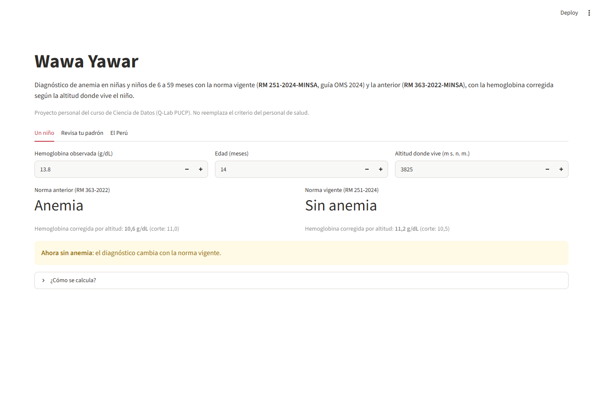
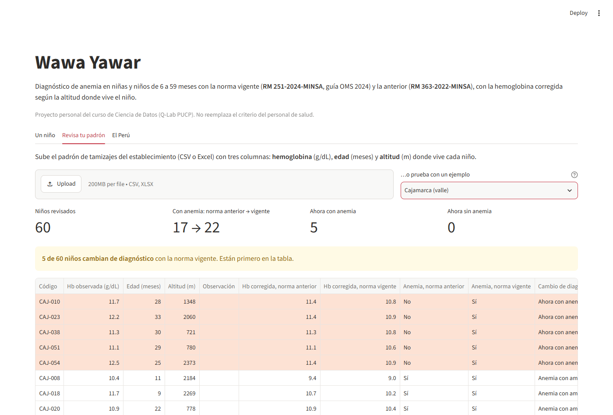
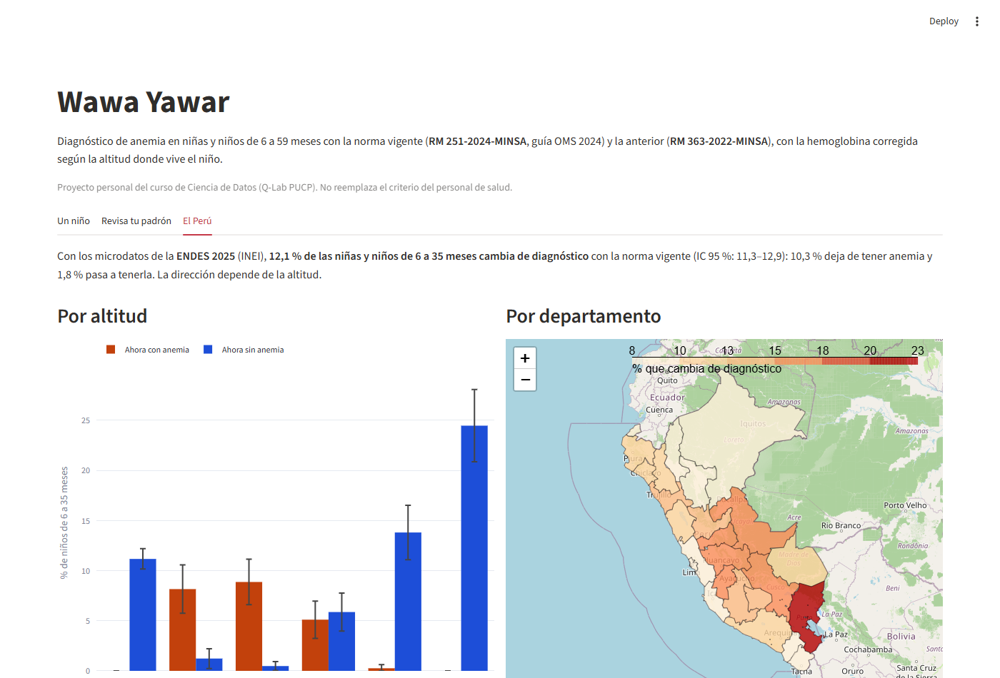

# Wawa Yawar

*Wawa yawar*: "la sangre del niño", en quechua.

> **Estado: en desarrollo.** Proyecto final de la Diplomatura de Especialización en Ciencia de Datos para las Ciencias Sociales y la Gestión Pública (Q-Lab PUCP), [issue #204](https://github.com/d2cml-ai/Data-Science-Python/issues/204). Presentación: miércoles 11 de noviembre de 2026. Las secciones marcadas *(en construcción)* se completan antes de esa fecha.

## Entregables

| Entregable | Enlace |
|---|---|
| Demo (URL pública) | **https://wawa-yawar.streamlit.app/** |
| Video de respaldo (60–90 s) | *(en construcción)* |
| Código de la app | [`app/app.py`](app/app.py) |
| Criterios de diagnóstico | [`app/wawa_yawar/criterios.py`](app/wawa_yawar/criterios.py) |
| Revisión del padrón | [`app/wawa_yawar/padron.py`](app/wawa_yawar/padron.py) |
| Cuántos niños cambian de diagnóstico | [`scripts/reclasificacion.py`](scripts/reclasificacion.py) |
| Pruebas | [`tests/`](tests/) (contra la ENDES y del padrón) |
| Conversaciones con usuarios | [`docs/research/`](docs/research/README.md) |
| Diagrama de arquitectura | [`docs/arquitectura.md`](docs/arquitectura.md) |

## 1. One-liner

**Ayudamos a los puestos de salud de la sierra y la selva alta a diagnosticar la anemia infantil con la norma vigente: la app corrige la hemoglobina según la altitud y revisa todo su padrón de tamizajes.**

## 2. Founder

*(Foto: en construcción.)*

**Fiorella Ampuero.** Trabajo en investigación para el desarrollo, con interés en el desarrollo infantil temprano. En la Tarea 3 del curso recalculé la anemia infantil de la ENDES 2025 con los dos criterios del MINSA y validé mis cifras contra las publicadas por el INEI ([anemia-altitud-peru](https://github.com/fampueroc/anemia-altitud-peru)). Este es un proyecto personal: no representa a mi empleador.

**Cómo cubro el equipo con agentes de IA:**

| Rol | Quién lo hace |
|---|---|
| Producto | Yo: conversaciones con usuarios, priorización del flujo, criterios clínicos de las normas |
| Ingeniería | Claude Code, con mi revisión y pruebas automáticas contra los microdatos del INEI |
| Diseño | Claude Code propone la interfaz en Streamlit y arma el video (grabación de la app con Playwright, voz clonada y subtítulos); yo decido el flujo y los textos, y reviso cada captura |
| Ventas | Yo: conversaciones con usuarios y presentación; Claude Code redacta borradores (el mensaje para pedir las conversaciones, el guion del video) que yo corrijo |

## 3. Problema *(en construcción)*

En abril de 2024 el MINSA adoptó la guía de la OMS para diagnosticar anemia (RM 251-2024-MINSA). Cambiaron dos cosas a la vez: la fórmula que ajusta la hemoglobina según la altitud y el punto de corte para niñas y niños de 6 a 23 meses.

Con los microdatos de la ENDES 2025, la anemia en niñas y niños de 6 a 35 meses pasa de **43,4 %** (criterio anterior, RM 363-2022) a **34,9 %** (criterio vigente). Pero el cambio no es parejo: **sube entre 7 y 11 puntos entre 500 y 2499 m y baja entre 14 y 34 puntos por encima de 3000 m** ([análisis de la Tarea 3](https://github.com/fampueroc/anemia-altitud-peru)). Hay niños que antes no figuraban con anemia y ahora sí, y otros al revés. Del diagnóstico depende el seguimiento que recibe cada niño.

- **Quién lo sufre:** *(en construcción: el rol preciso, a partir de las conversaciones)* quienes hacen el tamizaje de hemoglobina en los establecimientos del primer nivel de atención por encima de los 500 m, y quienes consolidan esas cifras en las redes de salud y las DIRESA.
- **Cuánto le cuesta, en diagnósticos que cambian** ([`scripts/reclasificacion.py`](scripts/reclasificacion.py), ENDES 2025, niñas y niños de 6 a 35 meses, IC 95 % con el diseño muestral):

  | Dónde | Cambia de diagnóstico | Ahora con anemia | Ahora sin anemia |
  |---|---:|---:|---:|
  | Perú | 12,1 % (11,3–12,9) | 1,8 % | 10,3 % |
  | 500–999 m | 9,4 % | 8,2 % | 1,2 % |
  | 1000–2499 m | 9,4 % | 8,9 % | 0,5 % |
  | 3500 m o más | 24,5 % | 0,0 % | 24,5 % |
  | Puno | 22,9 % | 1,8 % | 21,1 % |

  Es decir, **en el Perú, 1 de cada 8 niños cambia de diagnóstico con la norma vigente**, y la dirección depende de la altitud. Es descriptivo: no dice cuál norma es la correcta. Tablas completas: [`reclasificacion_altitud_2025.csv`](data/procesados/reclasificacion_altitud_2025.csv) y [`reclasificacion_departamento_2025.csv`](data/procesados/reclasificacion_departamento_2025.csv).
- **Cuánto le cuesta, en horas:** *(en construcción: con las conversaciones)*.
- **Cómo lo resuelve hoy:** *(en construcción: con las conversaciones)*.
- **Evidencia:** notas de 3 conversaciones con usuarios potenciales en [`docs/research/`](docs/research/README.md).

## 4. Solución e insight *(en construcción)*

- **Un niño:** se ingresa la hemoglobina, la edad y la altitud, y la app da el diagnóstico con los dos criterios y la hemoglobina ajustada.
- **Revisa tu padrón:** el establecimiento sube su Excel o CSV de tamizajes, y la app reclasifica a cada niño, pone primero a los que cambian de diagnóstico y descarga un reporte en Excel. Los padrones de ejemplo ([Puno](data/ejemplo/padron_puno.csv) y [Cajamarca, valle](data/ejemplo/padron_cajamarca.csv)) son 60 niños reales de la ENDES 2025, con códigos ficticios ([`scripts/padron_ejemplo.py`](scripts/padron_ejemplo.py)). En Puno, 10 de 60 niños dejan de tener anemia; en el valle de Cajamarca, 5 de 60 pasan a tenerla.
- **El Perú:** un gráfico por altitud y un mapa de Folium, con la ENDES, de dónde y cuánto cambia el diagnóstico.

**Insight:** el criterio nuevo no "baja la anemia" en todo el país; mueve el diagnóstico en las dos direcciones según la altitud. Sin una herramienta, ese cambio no se ve en el padrón del establecimiento.

## 5. Why now

- **La norma es reciente.** La RM 251-2024-MINSA (8 de abril de 2024) aprobó la NTS 213-MINSA/DGIESP-2024, que adopta la guía de la OMS publicada el 5 de marzo de 2024; luego la modificó la RM 429-2024-MINSA. Los establecimientos llevan poco tiempo diagnosticando con ella.
- **El cambio ya se ve en los registros de los establecimientos, no solo en la encuesta.** Con los datos del SIEN, Hernández-Vásquez y otros (*Acta Médica Peruana*, 2025) encuentran que en zonas de 3500 m o más la anemia baja de 31,3 % a 15,8 %, que entre 500 y 2500 m sube, y que hay distritos que cambian de categoría.
- **El ajuste nuevo no se calcula a mano.** Es una fórmula cuadrática desde 500 m, con un punto de corte distinto según la edad.
- **Ya se puede validar contra el INEI.** La ENDES publica la hemoglobina ajustada con los dos criterios (HC56 y HC56A), y la app reproduce esas variables niño por niño.

Fuentes completas en la [revisión de literatura de la Tarea 3](https://github.com/fampueroc/anemia-altitud-peru/blob/main/docs/literatura.md).

## 6. Demo *(en construcción)*

- **URL pública:** https://wawa-yawar.streamlit.app/ (Streamlit Community Cloud)
- **Video de respaldo:** *(en construcción).*
- **Correr en local:**

  ```bash
  uv sync
  uv run streamlit run app/app.py
  ```

- **Validación:** `uv run pytest` comprueba que las fórmulas de [`app/wawa_yawar/criterios.py`](app/wawa_yawar/criterios.py) reproducen, niño por niño, la hemoglobina ajustada que publica el INEI en la ENDES 2025 (variables HC56 y HC56A). Los microdatos se bajan con `uv run python scripts/obtener_datos.py`.
- **Capturas del flujo principal:**

  1. **Un niño:** a 3825 m y con 14 meses, una hemoglobina de 13,8 g/dL era anemia con la norma anterior y ya no lo es con la vigente.

     

  2. **Revisa tu padrón:** en el padrón de ejemplo de Cajamarca (valle), 5 de 60 niños pasan a tener anemia con la norma vigente.

     

  3. **El Perú:** cuántos niños cambian de diagnóstico por altitud y por departamento (ENDES 2025).

     
- **Arquitectura:** [`docs/arquitectura.md`](docs/arquitectura.md).
- **Modelos y APIs:** no usamos un LLM ni APIs de pago. El diagnóstico aplica las fórmulas oficiales de las dos normas, que son deterministas y están validadas contra el INEI; un modelo probabilístico no aporta aquí y podría equivocarse. Además, los datos del padrón no salen hacia terceros.

## 7. Modelo de negocio

Propuesta inicial, por validar con las conversaciones (máximo tres planes):

| Plan | Para quién | Qué incluye | Precio |
|---|---|---|---|
| Gratis | Cualquier establecimiento | Diagnóstico de un niño a la vez y la pestaña El Perú | S/ 0 |
| Establecimiento | Puesto o centro de salud | Revisa tu padrón y reporte en Excel | S/ 30 al mes + S/ 200 de implementación |
| Red / DIRESA | Redes de salud y DIRESA | Todos sus establecimientos, reporte consolidado y capacitación por grupos | S/ 20 al mes por establecimiento + S/ 200 de implementación por establecimiento |

**Por qué hay un plan gratis.** El diagnóstico de un niño a la vez no deja ganancia, pero permite que el personal de salud conozca la app y confíe en ella. La ganancia viene de quienes necesitan revisar padrones completos: los establecimientos y las redes. Quién decide las herramientas es "la dirección del establecimiento y las autoridades sanitarias" ([conversación 1](docs/research/conversacion_1.md)), y por eso los planes de pago son para ellos.

**Lo que no haremos:** ni publicidad ni venta de datos. Los padrones tienen datos de salud de niños, protegidos por la Ley 29733 de Protección de Datos Personales, y la app no los guarda: se procesan en memoria.

**Costos.** La app no usa tokens ni APIs de pago: el diagnóstico es un cálculo con fórmulas, así que atender a un establecimiento más casi no cuesta nada.

- **Costo fijo:** el demo corre gratis en Streamlit Community Cloud, pero los padrones tienen datos de salud de niños, así que la versión de pago iría en un servidor propio: un Droplet Basic de 2 GiB de DigitalOcean cuesta USD 12 al mes ([precios](https://www.digitalocean.com/pricing/droplets), consultado el 11-nov-2026), unos **S/ 41 al mes** con un tipo de cambio de S/ 3,418 por dólar (venta, sistema bancario SBS; BCRP, serie PD04640PD, 9-nov-2026).
- **Costo variable por usuario:** prácticamente S/ 0 (el padrón se procesa en memoria y no se guarda).

**Margen de contribución** (precio menos costo variable): cerca de S/ 30 al mes por establecimiento en el plan Establecimiento y S/ 20 en el plan Red, casi el 100 % del precio. Con **2 establecimientos** se cubre el servidor. 

**Análisis de costo.** El costo que de verdad pesa es mi tiempo. Lo valoro en S/ 65 por hora (mi costo de oportunidad). Capacitar un establecimiento para que aplique bien la app toma unas 3 horas (S/ 195), así que se cobra una **implementación única de S/ 200 por establecimiento**. En el plan Red, la capacitación es por grupos de establecimientos, lo que baja el costo por establecimiento. Con eso, la mensualidad es casi toda margen y el servidor (S/ 41 al mes) se cubre con 2 establecimientos.

## 8. Herramientas del curso

**Dentro del producto** (lo que usa el personal de salud):

| Herramienta | Sesión | Archivo | Por qué esta |
|---|---|---|---|
| Dashboard en Streamlit | 05 | [`app/app.py`](app/app.py) | Quien la usa es personal de salud, no programador: necesita un formulario y un botón para subir su padrón. |
| Mapa con Folium | 06 | [`app/app.py`](app/app.py) (pestaña "El Perú") | El problema es territorial: el cambio de diagnóstico depende de la altitud donde vive el niño. |

**Para preparar los datos:**

| Herramienta | Sesión | Archivo | Para qué |
|---|---|---|---|
| Descarga de datos públicos | 03 | [`scripts/obtener_datos.py`](scripts/obtener_datos.py) | Baja los microdatos de la ENDES 2025 del portal del INEI. |
| GeoPandas | 06 | [`scripts/preparar_mapa.py`](scripts/preparar_mapa.py) | Arma los 26 ámbitos que usa el INEI (con Lima Metropolitana y Lima Provincias por separado) a partir de los límites provinciales. |

**Para el video de respaldo** ([`video/`](video/README.md)):

| Herramienta | Sesión | Archivo | Para qué |
|---|---|---|---|
| Texto a tu voz (Qwen3-TTS) | 15 | [`video/narrar.py`](video/narrar.py) | Narra el guion con mi voz clonada, sin grabar cada toma. |
| Whisper | 13 | [`video/narrar.py`](video/narrar.py) | Subtítulos palabra por palabra y control de calidad de la voz. |
| Playwright | — | [`video/grabar.py`](video/grabar.py) | Graba la app pública en uso, con la duración exacta de cada frase. |

## 9. Qué hizo el agente

Trabajé con Claude Code (Anthropic) como socio técnico. Las decisiones de producto fueron mías: el problema, el usuario, las funciones, qué padrones de ejemplo usar, el nombre y cómo redactar los hallazgos. Claude Code escribió la mayor parte del código; yo lo revisé y lo probé en la app.

| Parte del repo | Qué hizo Claude Code | Qué hice yo |
|---|---|---|
| [`app/wawa_yawar/criterios.py`](app/wawa_yawar/criterios.py) | Pasó a un módulo las fórmulas de las dos normas que ya había programado en la Tarea 3 | Elegí las normas y validé las fórmulas en la Tarea 3 |
| [`app/wawa_yawar/padron.py`](app/wawa_yawar/padron.py) y [`app/app.py`](app/app.py) | Escribió la app, la lectura flexible del padrón, el reporte en Excel y el mapa | Definí las pestañas y el flujo; revisé los resultados en la app |
| [`scripts/reclasificacion.py`](scripts/reclasificacion.py) | Escribió el cálculo de cuántos niños cambian de diagnóstico, con el diseño muestral de la Tarea 3 | Aprobé la pregunta y revisé las cifras |
| [`scripts/padron_ejemplo.py`](scripts/padron_ejemplo.py) | Armó los padrones de ejemplo con niños reales de la ENDES | Elegí Puno y Cajamarca (valle) para mostrar los dos sentidos del cambio |
| [`tests/`](tests/) | Escribió las pruebas: las fórmulas reproducen la hemoglobina ajustada del INEI en todos los niños | Revisé que la prueba compare contra las variables del INEI |
| README y [`docs/`](docs/) | Redactó los borradores | Corregí el tono, el one-liner y el nombre; hago las conversaciones con usuarios |

**Reutilizado de la Tarea 3** ([anemia-altitud-peru](https://github.com/fampueroc/anemia-altitud-peru)): [`scripts/obtener_datos.py`](scripts/obtener_datos.py), [`scripts/preparar_mapa.py`](scripts/preparar_mapa.py) y [`data/ambitos.geojson`](data/ambitos.geojson).

## Estructura del repo

```
app/                    # app de Streamlit
  wawa_yawar/          # criterios de diagnóstico (RM 363-2022 y RM 251-2024)
data/                   # resultados agregados de la ENDES y límites departamentales
  originales/           # microdatos del INEI (no se suben; ver scripts/obtener_datos.py)
docs/                   # arquitectura, capturas y research/ con las 3 conversaciones
scripts/                # descarga y procesamiento de la ENDES
tests/                  # pruebas de los criterios contra la ENDES
```

## Fuentes

- INEI, ENDES 2025 y 2024, microdatos (módulos 1629 y 1638).
- RM 363-2022-MINSA y RM 251-2024-MINSA.
- Límites departamentales: INEI (2007), vía [juaneladio/peru-geojson](https://github.com/juaneladio/peru-geojson) (MPL-2.0).

## Licencia

[MIT](LICENSE).
